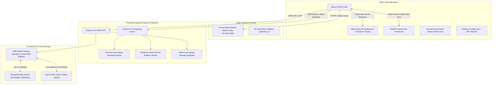
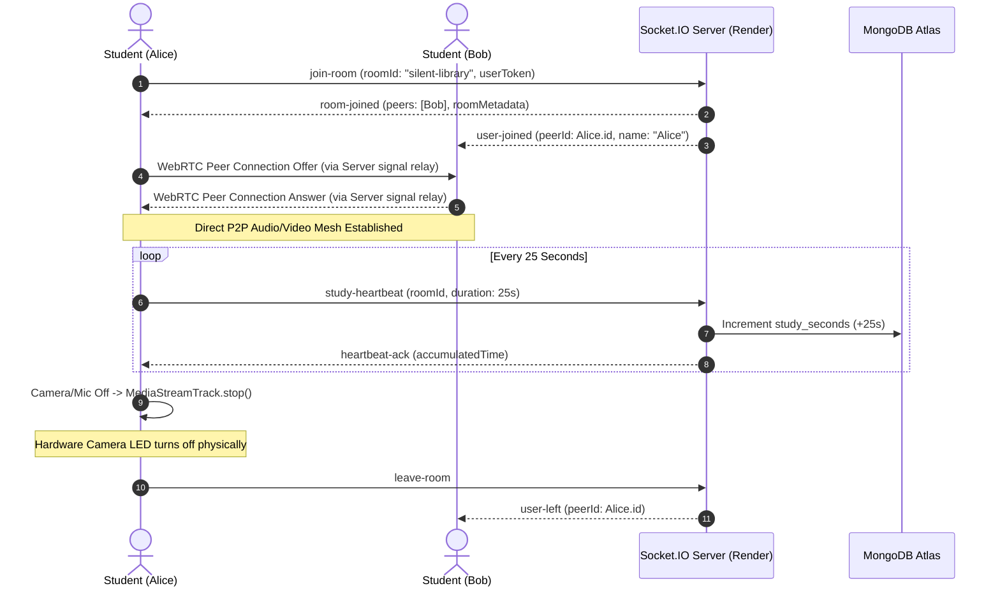

<div align="center">

# 🎓 StudySST — StudyStream Live

### 24/7 Virtual Focus Halls, Real-Time Peer Coworking & Student Community Platform

[](https://study-sst.vercel.app/)
[](https://drive.google.com/file/d/1FByKqnxugNhSuPZzjYLk8g13Xrhz0qP2/view?usp=sharing)
[](LICENSE)

<br/>

[](https://react.dev/)
[](https://vitejs.dev/)
[](https://tailwindcss.com/)
[](https://nodejs.org/)
[](https://expressjs.com/)
[](https://socket.io/)
[](https://www.mongodb.com/atlas)
[](https://www.sqlite.org/)
[](https://webrtc.org/)

<br/>

> **StudySST** is an always-on, real-time virtual study platform built to solve student isolation, chronic procrastination, and lack of social accountability. Students, software engineers, and researchers can join distraction-free study halls alongside peers globally, complete with low-latency WebRTC peer video, physical hardware-level privacy, procedural ambient soundscapes, anti-cheat verified study hour rankings, 1-to-1 direct messaging with a full Unicode emoji picker, and a student community knowledge hub.

---

### 🎥 Demonstration & Video Walkthrough
**[Watch the Full Video Walkthrough & Architectural Explanation on Google Drive](https://drive.google.com/file/d/1FByKqnxugNhSuPZzjYLk8g13Xrhz0qP2/view?usp=sharing)**  
*(Demonstrates live study halls, WebRTC peer video streaming, physical sensor release, procedural Web Audio synthesizer, live hour leaderboard, student profiles, and community blogs)*

---

</div>

## 📑 Table of Contents

- [System Architecture](#-system-architecture)
- [Key Features](#-key-features)
- [Interactive Audio Synthesizer](#-interactive-audio-synthesizer)
- [Dual-Database Persistence Engine](#-dual-database-persistence-engine)
- [Custom Room Lifecycle & Auto-Deletion](#-custom-room-lifecycle--auto-deletion)
- [Technology Stack](#-technology-stack)
- [Project Directory Structure](#-project-directory-structure)
- [Getting Started & Local Setup](#-getting-started--local-setup)
- [Environment Variables Configuration](#-environment-variables-configuration)
- [API & WebSocket Specification](#-api--websocket-specification)
- [Security & Engineering Integrity](#-security--engineering-integrity)
- [Automated Verification & Testing](#-automated-verification--testing)
- [Deployment Guide](#-deployment-guide)
- [License & Acknowledgments](#-license--acknowledgments)

---

## 🏛 System Architecture

StudySST employs a decoupled, high-resilience architecture consisting of a **React 19 Single Page Application (SPA)** deployed on Vercel, a **Node.js / Express / Socket.IO signaling daemon** on Render, and a **hybrid dual-write persistence tier** combining MongoDB Atlas in the cloud with a local WAL-mode SQLite cache.

### High-Level Architecture Diagram



### Real-Time WebRTC Mesh & Heartbeat Sequence



---

## ✨ Key Features

### 🏛 1. 24/7 Virtual Focus Halls & Custom Study Rooms
- **5 Permanent Public Study Halls**: Always-open virtual study spaces designed for specific study workflows:
  - 📚 **Silent Library** — Absolute quiet study hall with muted microphones.
  - ☕ **Lofi Cafe** — Relaxed ambient study environment with chill beats.
  - 💻 **STEM Sprint** — Technical focus hall for computer science, mathematics, and problem solving.
  - 🩺 **Med School** — High-intensity study room for medicine and long study blocks.
  - 🎨 **Creative Studio** — Collaborative hall for design, writing, and multidisciplinary projects.
- **Custom Study Rooms**: Students can create on-demand public or password-protected rooms with custom descriptions, study topics, and capacity limits.

### 🎥 2. Low-Latency WebRTC Video & Hardware-Level Privacy
- **Direct P2P Mesh Video Grid**: High-resolution, low-latency video feeds between peers inside study halls.
- **Physical Sensor Shutdown**: Clicking the camera or microphone off executes `track.stop()`, causing operating system camera indicators (green webcam LED on Mac/PC) to turn completely off immediately.
- **Dynamic Peer Grid**: Automatically adjusts layouts for 1, 2, 4, or up to 30 concurrent participants with zero ghost connections.
- **Restricted Guest Protection**: Unauthenticated guest users can enter rooms to view peers and listen to ambient sounds, but camera/mic publishing is strictly restricted to registered scholars.

### 💬 3. Live Study Chat, 1-to-1 Direct Messaging & Full Emoji Picker
- **In-Room Real-Time Chat**: Live room chat with synchronized time stamps and participant avatars.
- **Full Unicode Emoji Picker**: Integrated `emoji-picker-react` modal providing over 1,500 categorized Unicode emojis, search filtering, skin tone selection, and quick-reaction pills (`👏`, `🔥`, `💯`, `☕`, `⚡`).
- **1-to-1 Private Direct Messaging**: Click on any peer in the room to initiate an end-to-end private direct message thread without leaving the focus session.

### ⏱ 4. Anti-Cheat Study Hour Accounting & Global Leaderboard
- **Server-Authoritative Time Engine**: Study time is calculated exclusively on the server via periodic 25-second WebSocket heartbeats. Clients cannot artificially inflate hours via local storage or DOM manipulation.
- **Crash-Resistant Incremental Accrual**: Study progress commits incrementally to MongoDB Atlas, ensuring zero lost hours during unexpected disconnects.
- **Global Leaderboard Podiums**: Real-time rankings with daily, weekly, and all-time filters, featuring podium badges (#1 Gold, #2 Silver, #3 Bronze) and personal rank tracking.

### 👤 5. Student Profiles & Portfolio
- **Comprehensive Scholar Profiles**: Display custom bio, college/university, degree, academic year, total study hours, sessions completed, active streaks, and earned badges.
- **Shareable Profile URLs**: Deep-linked public profiles accessible via `?profile=username` or dedicated profile modals.
- **Inline Profile Customization**: Edit display name, bio, academic details, and avatar image with instant live reflection.

### ✍️ 6. Community Knowledge Hub
- **Markdown Blog Feed**: Publish articles, revision notes, and study tips categorized into Study Tips, Productivity, Coding, Motivation, and Science.
- **Interactive Community Actions**: Read blogs in a dedicated reader modal, toggle likes, participate in comment threads, and inspect author profiles.
- **Author Streaming Indicator**: Shows a live pulse badge on blog author avatars when they are currently active in a study hall.

### 🛡 7. Super Admin Moderation Panel
- **Dedicated Dashboard**: Restricted to authorized super administrator (`ujjwalprakash1812@gmail.com`).
- **Live System Metrics**: Monitor active socket connections, registered users, room occupancies, and total study hours across the platform.
- **Moderation Actions**: Inspect and terminate rogue rooms, delete inappropriate blogs, and manage user privileges.

### 🎵 8. Spotify Live Music Status
- **Opt-In Now-Playing Broadcast**: Connect Spotify to broadcast your current focus track to study room peers with album art and track metadata.

---

## 🎧 Interactive Audio Synthesizer

StudySST features a 100% in-browser, algorithmic Web Audio API sound synthesizer (`soundSynthesizer.js`). It creates high-fidelity, infinite ambient soundscapes with **zero external MP3 downloads or audio buffering delays**:

| Soundscape | Synthesis Method | Focus Application |
|---|---|---|
| 🌧️ **Gentle Rain** | Filtered white/pink noise buffer with multi-pole bandpass filtering | Deep concentration and background masking |
| ⛈️ **Distant Thunder** | Low-frequency modulated exponential decay oscillators | Dramatic atmospheric ambiance |
| ☕ **Lofi Coffee Shop** | Layered bandpass pink noise with random chatter envelope modulation | Social co-working presence |
| 🧠 **10Hz Alpha Waves** | Dual sine oscillators creating a 10Hz binaural beat frequency | Cognitive performance and flow state |
| 🔥 **Crackling Fire** | Random pulse generator with high-resonance bandpass shaping | Warmth, relaxation, and evening reading |
| 🌊 **Ocean Waves** | Low-frequency sinusoidal LFO modulating noise gain | Breathing rhythm and stress reduction |
| 🌲 **Forest Birds** | High-frequency FM frequency sweeps with exponential envelopes | Restorative daytime alertness |
| ⚪ **White Noise** | Uniform Gaussian audio buffer with flat spectral density | Immediate conversation masking |
| 🌸 **Pink Noise** | $1/f$ filtered audio buffer with equal energy per octave | Long-term study endurance |
| 🟤 **Brown Noise** | $1/f^2$ integrated brownian motion buffer with deep bass rolloff | ADHD focus and hyperactivity calming |
| 🦗 **Summer Crickets** | Dual high-pitch pulse modulated oscillators | Late-night focus atmosphere |
| 🕰️ **Clock Ticking** | Sharp micro-transient impulses at 1.0-second intervals | Pomodoro pacing and discipline |

---

## 💾 Dual-Database Persistence Engine

To guarantee zero data loss across GitHub pushes, Vercel edge rebuilds, and Render container cold starts, StudySST implements a dual-database architecture:

```
                            ┌───────────────────────────────┐
                            │    Client Mutation Request    │
                            └───────────────┬───────────────┘
                                            │
                                            ▼
                            ┌───────────────────────────────┐
                            │    Express / Socket.IO API    │
                            └───────┬───────────────┬───────┘
                                    │               │
        Low-Latency Local Read/Write │               │ Async Dual-Write
                                    ▼               ▼
                      ┌───────────────────┐   ┌───────────────────────────┐
                      │ SQLite WAL Cache  │   │   MongoDB Atlas (Cloud)   │
                      │ (better-sqlite3)  │   │   (Mongoose Schemas)      │
                      └───────────────────┘   └───────────────────────────┘
                                ▲                           │
                                └───────── Hydrate ─────────┘
                                   (On Server Boot/Restart)
```

1. **MongoDB Atlas as Cloud Truth**: All collections (`users`, `rooms`, `blogs`, `messages`, `study_sessions`, `live_sessions`) are permanently stored in MongoDB Atlas cloud clusters.
2. **Startup Hydration**: When the backend process boots on Render (or wakes from sleep), it queries MongoDB Atlas and synchronizes existing records into SQLite WAL memory.
3. **Dual-Write Consistency**: Every write operation (registration, blog creation, like toggle, room creation, study session commit) writes to both MongoDB and the local cache.

---

## ⏳ Custom Room Lifecycle & Auto-Deletion

StudySST automatically maintains server hygiene by pruning abandoned custom study rooms:

- **Permanent Room Immunity**: The 5 original study halls (`silent-library`, `lofi-cafe`, `stem-sprint`, `med-school`, `creative-studio`) are strictly flagged as permanent and can never be deleted.
- **15-Minute Countdown**: When the last participant leaves a custom room, a 15-minute inactivity countdown begins on the backend.
- **Auto-Cancellation on Reconnect**: If any student enters the room before the 15-minute timer expires, the scheduled deletion is automatically cancelled and the room returns to an active state.
- **Authoritative Destruction**: If 15 continuous minutes elapse with zero participants, the room is permanently removed from MongoDB Atlas and SQLite, and the `room-deleted` event is broadcast to all clients.

---

## 🛠 Technology Stack

| Domain | Technology | Version | Purpose in StudySST |
|---|---|---|---|
| **Frontend Framework** | React | `19.0.0` | UI component tree, state management, and lifecycle hooks |
| **Build Tooling** | Vite | `6.2.0` | Sub-second HMR and optimized production bundling |
| **Styling & Theme** | Tailwind CSS | `3.4.17` | Cohesive 5-color earthy palette and global dark mode |
| **Icons** | Lucide React | `1.16.0` | Clean, modern iconography across all modals and views |
| **Emoji Engine** | Emoji Picker React | `5.1.4` | Full Unicode emoji library with categories and search |
| **Celebrations** | Canvas Confetti | `1.9.4` | Visual reward triggers upon completing study milestones |
| **Real-Time Client** | Socket.IO Client | `4.8.1` | Low-latency WebSockets and WebRTC mesh signaling |
| **WebRTC & Media** | Native WebRTC | Modern Spec | Direct peer-to-peer audio and video streaming |
| **Sound Synthesis** | Web Audio API | Native Spec | Real-time procedural ambient audio generator |
| **Backend Runtime** | Node.js | `20+` | High-throughput non-blocking asynchronous event loop |
| **Web Framework** | Express | `4.19.2` | RESTful routing, CORS handling, and middleware stack |
| **Real-Time Engine** | Socket.IO | `4.7.5` / `4.8.1` | Signaling server, heartbeat accounting, and room presence |
| **Cloud Database** | MongoDB Atlas / Mongoose | `8.12.1` / `9.11.4` | Authoritative persistent cloud document storage |
| **Local Cache** | SQLite (`better-sqlite3`) | `11.8.1` | Instant local runtime caching with WAL mode |
| **Authentication** | JWT & Bcrypt | `9.0.2` / `5.1.1` | Secure password hashing and tamper-proof bearer tokens |
| **Federated Auth** | Firebase | `13.1.0` | 1-Click Google Sign-In authentication |
| **File Storage** | Multer | `1.4.5-lts.1` | Secure multipart form upload processing for avatars & covers |
| **Hosting (Client)** | Vercel | Production | High-availability global Edge network CDN |
| **Hosting (Server)** | Render | Production | Persistent Node.js background daemon with WebSocket support |

---

## 📂 Project Directory Structure

```text
studystream-live/
├── api/
│   └── index.js                      # Vercel serverless entrypoint fallback
├── client/                           # Frontend React SPA
│   ├── public/                       # Static public assets
│   ├── src/
│   │   ├── components/               # React UI Views & Modals
│   │   │   ├── AdminView.jsx         # Super Admin moderation dashboard
│   │   │   ├── AnalyticsView.jsx     # Personal study statistics and charts
│   │   │   ├── AuthModal.jsx         # Login, registration & Google auth modal
│   │   │   ├── BlogCommunityView.jsx # Knowledge hub blog feed & filters
│   │   │   ├── BlogDetailModal.jsx   # Full blog reading modal with comments
│   │   │   ├── BlogEditorModal.jsx   # Blog creation modal with cover upload
│   │   │   ├── EditProfileModal.jsx  # Student profile editing modal
│   │   │   ├── FocusRoomView.jsx     # WebRTC video grid, chat, Pomodoro & audio
│   │   │   ├── LeaderboardView.jsx   # Global verified study hour rankings
│   │   │   ├── LobbyView.jsx         # Study halls selection & room creator
│   │   │   ├── Navbar.jsx            # Main navigation, presence & auth actions
│   │   │   ├── ProfileModal.jsx      # Quick-view student profile popup
│   │   │   └── ProfileView.jsx       # Complete student portfolio & stats page
│   │   ├── context/
│   │   │   ├── AuthContext.jsx       # Global user authentication state
│   │   │   ├── PresenceContext.jsx   # Global peer presence and status
│   │   │   └── ThemeContext.jsx      # Light/Dark mode theme engine
│   │   ├── utils/
│   │   │   ├── api.js                # Axios/Fetch HTTP wrapper with JWT interceptor
│   │   │   ├── firebase.js           # Firebase Google Authentication client
│   │   │   └── soundSynthesizer.js   # 12-track procedural Web Audio engine
│   │   ├── App.jsx                   # Main application router & error boundaries
│   │   ├── index.css                 # Tailwind directives and custom scrollbars
│   │   └── main.jsx                  # React DOM root entrypoint
│   ├── index.html                    # Single page HTML shell
│   ├── package.json                  # Client dependencies and scripts
│   ├── tailwind.config.js            # StudySST 5-color palette configuration
│   └── vite.config.js                # Vite build and proxy settings
├── server/                           # Backend Node.js server
│   ├── models/                       # Mongoose schemas
│   │   ├── Blog.js                   # Community blog schema
│   │   ├── DirectMessage.js          # 1-to-1 private message schema
│   │   ├── LiveSession.js            # Active socket presence schema
│   │   ├── Message.js                # In-room public chat schema
│   │   ├── Room.js                   # Study room & lifecycle metadata schema
│   │   ├── StudySession.js           # Historical study session records
│   │   ├── Task.js                   # Goal and Pomodoro task schema
│   │   └── User.js                   # Student user profile schema
│   ├── scripts/                      # Automated test & maintenance suites
│   │   ├── clean_dummy_data.js       # Production database sanitizer
│   │   ├── test_custom_room_lifecycle.js  # 15-minute auto-deletion test
│   │   ├── test_part1_to_4_verification.js # End-to-end integration test suite
│   │   ├── test_student_profile.js   # Student profile CRUD test suite
│   │   └── test_helpers.js           # Test harness utilities
│   ├── uploads/                      # Uploaded avatars and blog cover images
│   ├── db.js                         # SQLite WAL engine (better-sqlite3)
│   ├── mongodb.js                    # MongoDB Atlas connection & sync logic
│   ├── package.json                  # Server dependencies and scripts
│   └── server.js                     # Express app, Socket.IO server & API routes
├── package.json                      # Workspace root scripts
├── vercel.json                       # Vercel deployment and routing rules
└── README.md                         # Comprehensive documentation
```

---

## 🚀 Getting Started & Local Setup

### Prerequisites
- **Node.js** v20.0.0 or higher
- **npm** v10.0.0 or higher
- A free **MongoDB Atlas** cluster connection string (or local MongoDB)

### Step-by-Step Installation

1. **Clone the repository:**
   ```bash
   git clone https://github.com/UjjwalPrakash12/StudySST.git
   cd StudySST
   ```

2. **Install all workspace dependencies:**
   ```bash
   npm run install:all
   ```
   *(This installs root, backend, and frontend dependencies in a single step).*

3. **Configure environment variables:**
   Create a `.env` file inside the `server/` directory:
   ```bash
   cp server/.env.example server/.env
   ```
   *(See [Environment Variables](#-environment-variables-configuration) below for details).*

4. **Start the application in development mode:**
   ```bash
   npm run dev
   ```
   - Frontend opens at: `http://localhost:3000` (or `http://localhost:5173`)
   - Backend API runs at: `http://localhost:5050`

5. **Or build and run in production mode:**
   ```bash
   npm run build
   npm start
   ```
   - Open your browser at: `http://localhost:5050`

---

## 🔐 Environment Variables Configuration

### 1. Backend Server (`server/.env` or Render Dashboard)

| Variable | Description | Example / Default |
|---|---|---|
| `PORT` | Port for Express & Socket.IO server | `5050` |
| `NODE_ENV` | Runtime environment mode | `production` or `development` |
| `JWT_SECRET` | Secret key for signing and verifying JWT tokens | `generate_with_openssl_rand_hex_32` |
| `CORS_ORIGIN` | Allowed CORS origins for browser security | `https://study-sst.vercel.app,http://localhost:3000` |
| `MONGODB_URI` | MongoDB Atlas connection string | `mongodb+srv://<user>:<password>@cluster0.mongodb.net/studystream?retryWrites=true&w=majority` |

### 2. Frontend Client (`client/.env` or Vercel Project Settings)

| Variable | Description | Example / Default |
|---|---|---|
| `VITE_API_URL` | Base URL of the running backend server | `https://your-studysst-backend.onrender.com` |
| `VITE_FIREBASE_API_KEY` | Firebase Client API Key (Google Auth) | `your_firebase_api_key` |
| `VITE_FIREBASE_AUTH_DOMAIN` | Firebase Authentication Domain | `your_project.firebaseapp.com` |
| `VITE_FIREBASE_PROJECT_ID` | Firebase Project Identifier | `your_project_id` |

> 🔒 **Security Notice**: Never commit `.env` files containing live credentials to GitHub. Always configure production secrets directly inside the **Vercel** and **Render** management dashboards.

---

## 📡 API & WebSocket Specification

### Core REST Endpoints

| Method | Endpoint | Description | Auth Required |
|---|---|---|---|
| `POST` | `/api/auth/register` | Register a new scholar account | No |
| `POST` | `/api/auth/login` | Authenticate with email/password and obtain JWT | No |
| `POST` | `/api/auth/google` | Verify Firebase ID token and authenticate | No |
| `GET` | `/api/auth/me` | Fetch currently authenticated user session | Yes (Bearer) |
| `GET` | `/api/users/profile/:identifier` | Fetch public student profile by ID or username | Optional |
| `PUT` | `/api/users/profile` | Update profile details (bio, university, degree) | Yes (Bearer) |
| `GET` | `/api/rooms` | List all permanent and active custom rooms | No |
| `POST` | `/api/rooms` | Create a new custom study room | Yes (Bearer) |
| `GET` | `/api/blogs` | Retrieve paginated community blog articles | No |
| `POST` | `/api/blogs` | Publish a new community blog article | Yes (Bearer) |
| `POST` | `/api/blogs/:id/like` | Toggle like status on a blog post | Yes (Bearer) |
| `POST` | `/api/blogs/:id/comments` | Post a comment on a blog post | Yes (Bearer) |
| `GET` | `/api/leaderboard` | Retrieve verified study hour rankings | No |
| `GET` | `/api/admin/stats` | Super Admin system metrics and statistics | Super Admin Only |
| `GET` | `/api/spotify/current` | Retrieve currently playing Spotify track | Optional |

### Real-Time WebSocket Events

| Event Name | Direction | Payload | Description |
|---|---|---|---|
| `join-room` | Client ➔ Server | `{ roomId, token, isGuest }` | Join a study hall and initiate presence |
| `user-joined` | Server ➔ Room | `{ peerId, user }` | Broadcast new participant to existing peers |
| `signal` | Bi-directional | `{ to, from, signal }` | WebRTC SDP offer/answer/ICE candidate relay |
| `chat-message` | Client ➔ Server | `{ roomId, text, emoji }` | Broadcast public message to study hall |
| `private-message` | Client ➔ Server | `{ toUserId, text }` | Send private 1-to-1 direct message |
| `study-heartbeat` | Client ➔ Server | `{ roomId, seconds: 25 }` | Verify study presence and accrue hours |
| `room-deleted` | Server ➔ Clients | `{ roomId, reason }` | Broadcast custom room auto-deletion |

---

## 🔒 Security & Engineering Integrity

- **Physical Sensor Shutdown**: Complete invocation of `MediaStreamTrack.stop()` ensures the device's physical camera and microphone sensors disengage immediately upon muting.
- **Strict Role-Based Access Control**:
  - **Super Admin (`ujjwalprakash1812@gmail.com`)**: Full system oversight, room deletion, and blog moderation.
  - **Authenticated Scholars**: Full audio/video streaming, blog authoring, liking, commenting, and direct messaging.
  - **Restricted Guests**: Ephemeral 10-minute preview access; publishing video, audio, or persistent chat is strictly blocked.
- **SQL Injection Defense**: All SQLite queries use parameterized prepared statements (`?` placeholders).
- **Anti-Cheat Time Verification**: Study hours are computed on the server side using 25-second socket heartbeats, preventing client-side spoofing.
- **Hardened HTTP Security Headers**: Configured with `X-Content-Type-Options: nosniff`, `X-Frame-Options: SAMEORIGIN`, and disabled `X-Powered-By`.

---

## 🧪 Automated Verification & Testing

StudySST includes a suite of automated integration scripts verifying end-to-end functionality:

```bash
# Run comprehensive verification suite (Auth, WebRTC permissions, Data hygiene, Emoji engine)
node server/scripts/test_part1_to_4_verification.js

# Test custom room 15-minute auto-deletion and lifecycle
node server/scripts/test_custom_room_lifecycle.js

# Test student profile creation, updates, and privacy
node server/scripts/test_student_profile.js
```

### Verification Test Suite Coverage:
- ✅ **Authentication**: Valid sessions bypass camera/mic login prompts; expired sessions refresh cleanly.
- ✅ **Guest Restrictions**: Ephemeral guests cannot access camera/mic or publish media streams.
- ✅ **Database Cleanliness**: Production databases are validated against fake accounts and test debris.
- ✅ **Room Lifecycle**: Empty custom rooms trigger a 15-minute countdown and cancel on rejoin; permanent rooms never delete.
- ✅ **UI Resilience**: Error boundaries protect views against unmounted component exceptions.

---

## 🌐 Deployment Guide

### Deploy Frontend to Vercel
1. Fork or push the repository to GitHub.
2. Go to the [Vercel Dashboard](https://vercel.com/) and click **"Add New Project"**.
3. Select your `StudySST` repository.
4. Configure build settings:
   - **Framework Preset**: `Vite`
   - **Root Directory**: `./` (or `client`)
   - **Build Command**: `npm --prefix client run build`
   - **Output Directory**: `client/dist`
5. Add Environment Variables:
   - `VITE_API_URL`: Your deployed Render backend URL (e.g., `https://studysst.onrender.com`).
6. Click **Deploy**.

### Deploy Backend to Render
1. Go to the [Render Dashboard](https://render.com/) and click **"New +" ➔ "Web Service"**.
2. Connect your GitHub repository.
3. Configure service settings:
   - **Environment**: `Node`
   - **Build Command**: `npm --prefix server install`
   - **Start Command**: `node server/server.js`
4. Add Environment Variables in Render:
   - `NODE_ENV`: `production`
   - `PORT`: `5050`
   - `JWT_SECRET`: A secure random 64-character hex string
   - `CORS_ORIGIN`: `https://study-sst.vercel.app`
   - `MONGODB_URI`: Your MongoDB Atlas connection URI
5. Click **Create Web Service**.

---

## 📄 License & Acknowledgments

This project is licensed under the **MIT License** — see the [LICENSE](LICENSE) file for details.

### Author
- **Ujjwal Prakash** — Lead Developer & Architecture  
- **GitHub**: [@UjjwalPrakash12](https://github.com/UjjwalPrakash12)  
- **Live Website**: [https://study-sst.vercel.app/](https://study-sst.vercel.app/)  
- **Project Walkthrough Video**: [Watch on Google Drive](https://drive.google.com/file/d/1FByKqnxugNhSuPZzjYLk8g13Xrhz0qP2/view?usp=sharing)

<div align="center">
<br/>
<sub>Built with precision and care for students and lifelong scholars worldwide.</sub>
</div>
